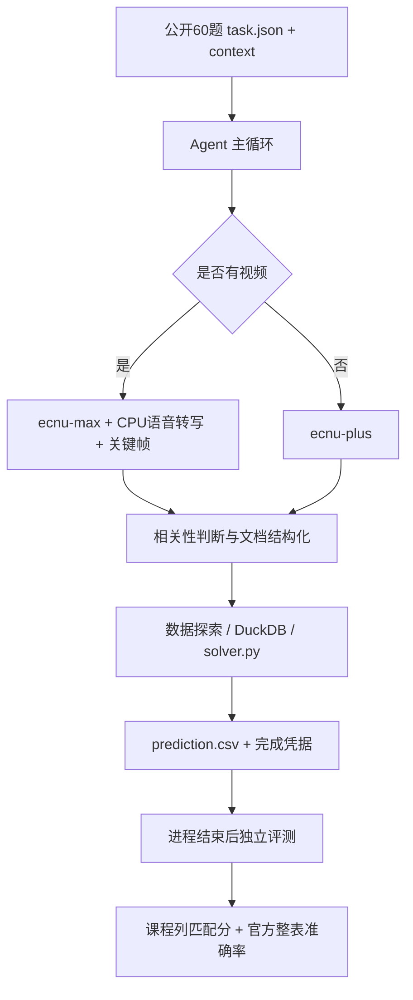

# 系统结构与改进范围

## 核心入口

| 文件 | 职责 |
|---|---|
| `champion/src/data_agent_baseline/zz_agent_v2.py` | 批量任务、工具循环、阶段计时与完成记录 |
| `tools_v2/general_tools.py` | 模型配置、按视频输入路由、客户端构造 |
| `tools_v2/model_http.py` | 异步限流、429 重试、脱敏请求用量 |
| `tools_v2/speed_runtime.py` | 同步/异步共享预算、冷却恢复、后台视频单路执行 |
| `tools_v2/artifact_cache.py` | 文档缓存指纹、完整性检查与原子写入 |
| `tools_v2/run_state.py` | 源码、输入、模型及设置指纹和完成凭据 |
| `doc_tools/doc_prepare.py` | 文档抽取、缓存使用和结构化表生成 |
| `video/frame_html_tool.py` | 视频截图转版面文本，继承任务模型与线程上下文 |

表中 `tools_v2/`、`doc_tools/`、`video/` 相对 `champion/src/data_agent_baseline/`。

## 本项目新增与适配

上游已有 Agent、数据处理和多模态流程。本项目新增文档缓存、共享请求预算、完成凭据与实验管理模块，并适配 ECNU API。相关性投票、分区抽取和求解循环仍来自参考系统，不能将整个参考实现当作本项目从零开发。

模型路由读取任务上下文中的编号，再检查输入目录是否存在视频；编号仅用于定位输入，不包含逐题答案或硬编码模型清单。线程通过 contextvars 继承模型路由，截图识别也读取同一任务配置。

进程内所有模型请求受共享预算限制；它不限制同一令牌在其他程序中的调用。HTTP 指标保存状态、模型名、耗时和用量，不保存鉴权头或完整请求体。历史未覆盖同步调用的指标不能与修复后的请求计数直接作总量比较。

缓存仅复用完整成功的文档抽取，身份包括内容、知识背景、模型、思考配置、相关代码与依赖锁。失败分区、转换错误或校验失败的缓存会被拒绝；不缓存 gold 或任务预测。未声明模型版本时，缓存按日期隔离。

## 实验与评测边界

`completion.json` 说明模型流程正常结束、CSV 可读且哈希匹配，不证明业务答案正确。模型/源码变化后保留旧输出需要显式审查并记录来源，不能绕过验证直接改指纹。

课程评分按列匹配并按 `λ=0.1` 扣除多余预测列；官方评测按配置进行类型归一和完整行关系比较。两者应并列报告，不能互相替代。

公开结果是“33份历史plus + 27份max”的恢复性实验。未来若验证纯统一路由方案，应另建干净实验，固定输入、缓存策略、代码及模型配置，完整运行60题。
