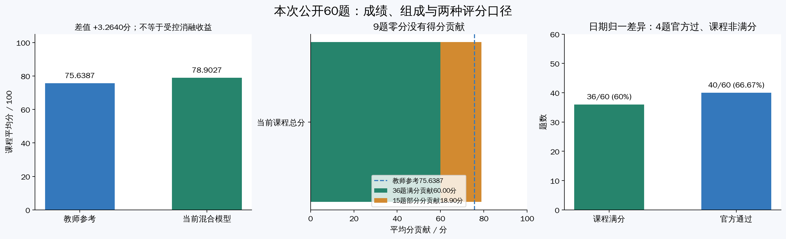
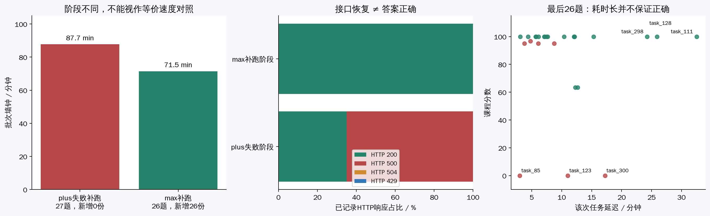
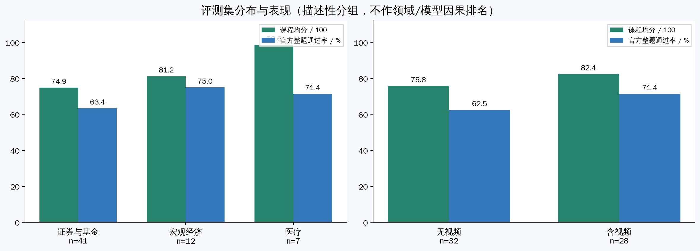
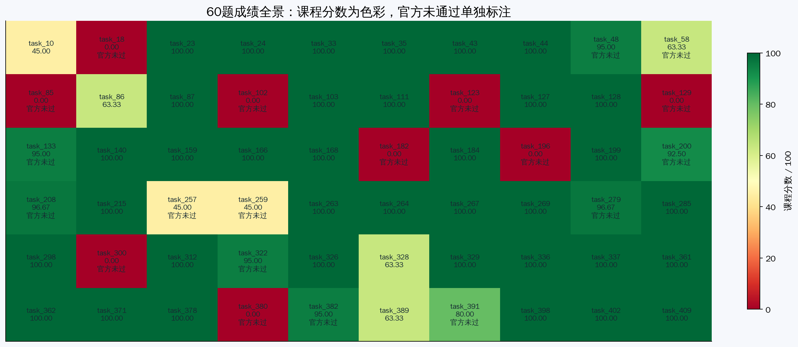
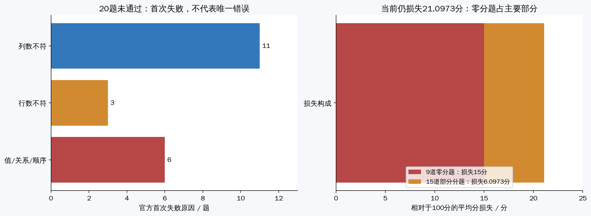
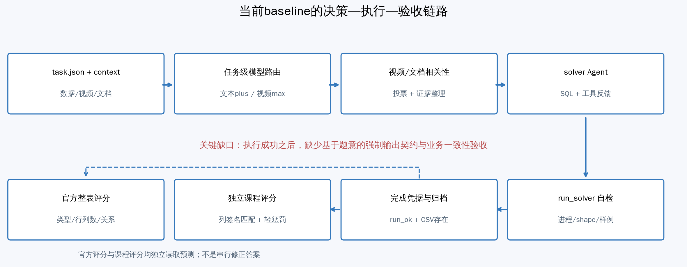

# Baseline全量实验总结与评价

> 实验对象：`baseline_full_20261025`；分析日期：2026年10月26日。本文依据公开60题最终预测、两种评分结果、保留日志及当前源码整理。文中建议尚未实施，原预测和评分未修改。

## 一、总体结论

当前Agent已经完成公开60题的端到端处理，课程评分为 **78.9027/100**，超过课件中的教师参考基线 **3.2640分**；官方整题评测通过 **40/60题，66.67%**。

它具备较完整的数据接入、SQL执行、视频理解和失败恢复能力，但“程序成功产出CSV”和“答案符合业务要求”之间仍有明显差距。主要问题集中在输出列、记录与实体粒度、去重计数、视频证据与结构化字段对应关系。

**本轮最明确的工程收益是修复接口链路、补齐此前缺失的27题结果；超过教师参考的3.2640分是已核实的总成绩差值，但尚不能全部归因于某个单独的代码改进。**

## 二、实验结果与运行情况

### 2.1 最终成绩

| 指标 | 结果 |
|---|---:|
| 评测范围 | 固定公开60题 |
| 最终有效预测 | 60/60 |
| 课程平均分，λ=0.1 | **78.9027** |
| 教师参考分 | 75.6387 |
| 相对参考差值 | **+3.2640分，约+4.32%** |
| 课程满分 / 部分分 / 零分 | 36 / 15 / 9题 |
| 官方整题通过 | **40/60，66.67%** |
| 最终输出来源 | 33份历史ecnu-plus输出 + 27份ecnu-max补跑输出 |



36道满分题贡献60分，15道部分分题贡献18.9027分，组成最终78.9027分。相对于100分，9道零分题造成15分损失，部分分题造成约6.0973分损失。因此，输出规范值得优先优化，而解决零分题仍是提高成绩的主要空间。

### 2.2 运行过程与耗时

| 阶段 | 耗时 | 结果与解释 |
|---|---:|---|
| 首次启动至最终评分 | 约10小时51分 | 包括调试、接口故障、重试、参数切换与WSL中断 |
| plus失败补跑27题 | 约87分44秒 | 新增有效预测0份 |
| max单题验证 | 约3分4秒 | task_102生成CSV，但最终得0分 |
| 最后max补跑26题 | **71分29秒** | 新增26份有效预测 |

这些时间范围不同，不能相加，也不能将71分钟称为从零完成全部60题的时间。

最后26题补跑吞吐约 **21.83题/小时**，单题平均延迟约10分43秒、中位数约8分11秒。任务并发4、请求合计上限2，使多个任务的延迟相互重叠，平均每完成一题摊销墙钟约2分45秒。



旧plus失败阶段记录了1841次HTTP 500；最后26题max补跑有1575次HTTP 200、1次429，没有500。接口恢复使流程能够继续，但没有消除答案错误：task_300耗时约17分钟仍为0分，task_111耗时约32分钟则为满分。

## 三、为什么比教师参考高了约3分

### 3.1 两种提升必须分开解释

| 比较对象 | 分数变化 | 归因结论 |
|---|---:|---|
| 本机不完整结果 → 本机完整结果 | 42.0972 → 78.9027，**+36.8055** | 可明确归因于新增27题输出 |
| 教师参考 → 本机完整结果 | 75.6387 → 78.9027，**+3.2640** | 总分差成立，模块贡献尚不能分解 |

原33份预测的哈希没有改变。新增27题平均81.79分，对60题均分的新增贡献为：

```text
27 × 81.79 ÷ 60 = 36.8055分
```

因此，本机恢复前后的大幅增长主要是从“缺失计零”恢复为实际结果，不是相同题目的推理能力突然提高36.8分。

### 3.2 教师与本次并非完全相同的运行条件

课程PPT给出教师参考使用 **32题ecnu-max、28题ecnu-plus**；本次最终结果使用 **27题max、33题plus**，且包含历史复用和试跑导入。

目前没有教师的逐题预测、模型分配、完整提示词、模型版本、缓存和重试配置。因此，虽然任务范围和课程λ一致，仍不能将3.2640分解释成严格受控的代码优化收益。当前max题数还更少，也不能说是“用了更多max所以高分”。

有日志支持的解释是：

1. **兼容性修复保证了覆盖。** 原先plus图片调用持续500，任务级模型路由使视频题通过max继续执行。
2. **现有工具体系能正确解决较多任务。** 统一数据查询、固定solver执行和错误反馈支撑了36道课程满分题。
3. **部分分机制保留了不少正确列的贡献。** 多余列通常只受轻惩罚，因此部分官方失败题仍有较高课程分。

这些因素共同解释当前78.90分的形成，但第三项同样适用于教师采用的课程评分，不能单独解释相对教师的3.2640分。要精确归因，需要取得教师逐题结果，并固定运行条件做模块消融。

**报告中适合使用的表述：**

> 本方案在公开60题、λ=0.1的课程评测中取得78.9027分，高于课件参考约3.2640分。日志证实，接口兼容性修复恢复了此前缺失的结果；但由于教师逐题输出与完整配置未取得，目前只能确认总成绩优势，不能将全部差值归因于单一模块。

## 四、评测集分布与Agent能力



### 4.1 输入模态

| 输入类型 | 题数 | 课程均分 | 官方通过率 |
|---|---:|---:|---:|
| 无视频 | 32 | 75.81 | 62.50% |
| 含视频 | 28 | 82.44 | 71.43% |

视频题占46.7%，是评测的核心组成。视频可能直接给出答案，也可能只提供阈值、单位、范围或分组规则，要求Agent再查询结构化数据。

当前视频链路已经可用，但两组面对不同题目、模型和运行条件，不能据此认定视频更简单或max在同题上更强。

### 4.2 问题领域

以下按题意人工分类，不是官方领域标签。

| 领域 | 题数及占比 | 课程均分 | 官方通过 |
|---|---:|---:|---:|
| 证券、基金与公司信息 | 41，68.3% | 74.86 | 26/41 |
| 宏观经济与资产负债表 | 12，20.0% | 81.25 | 9/12 |
| 医疗记录与术语 | 7，11.7% | 98.57 | 5/7 |

总体成绩主要受金融题影响，9道零分题全部在证券/基金组。该组中相似字段、跨表关联、去重、排名并列和视频业务口径较多，应作为后续重点。

医疗题样本只有7题，课程均分很高，但两题因额外列未通过官方评测；不能据此推广为通用医疗领域优势。宏观题没有零分，主要损失与日期、输出列和数据内容匹配有关。



## 五、为什么78.90分不等于78.90%的题完整正确

### 5.1 两种评分器检查的对象不同

课程评分在 [`run_compare_to_gt.py`](../../champion/src/data_agent_baseline/run_compare_to_gt.py) 中实现。每列经归一化、排序后形成签名，再匹配列签名多重集：

```text
M：匹配列数；G：目标列数；P：预测列数
单题分 = 100 × max(0, M/G - 0.1 × (P-M)/P)
```

例如，目标1列完全正确，但额外输出1列，可得95分。官方评分则先检查列数和行数，再按配置检查类型、字段关系与顺序，这种输出会直接失败。

课程列签名忽略列名和行顺序，但保留重复值与空值；它不是逐格正确率。一整列中某项变化，都可能使该列无法完整匹配。列内容分别匹配也不充分证明行内字段配对正确，因此还需要整表与业务检查。

### 5.2 当前失败构成

| 官方首次失败原因 | 题数 | 主要含义 |
|---|---:|---|
| 列数不一致 | 11 | 额外字段或缺少目标字段 |
| 行数不一致 | 3 | 筛选、关联、去重或范围存在偏差 |
| 值、关系或顺序不匹配 | 6 | 形状基本符合，但内容未通过 |



“首次失败”不等于唯一原因。task_300首先报列数，但实际还有行集问题；不能把11道列数失败题都当作删列即可修复。

另外，task_10、86、328、389在官方评分中通过，课程却没有满分，主要涉及日期与午夜时间戳的归一化差异。若通过通用规则修复且不伤害其他题，理论增益上限约2.75分；这是分析上限，不是已实现成绩，也不能根据gold逐题修改输出。

## 六、从现象追到代码原因



### 6.1 核心缺口：运行成功之后，没有强制验证业务要求

[`zz_agent_v2.py`](../../champion/src/data_agent_baseline/zz_agent_v2.py) 的正常结束条件主要是：

```python
if run_ok and prediction_file.exists():
    break
```

这能防止旧CSV冒充本次成功，但无法验证题目要求几列、计数还是明细、是否允许去重。

[`run_solver_tool.py`](../../champion/src/data_agent_baseline/tools_v2/run_solver_tool.py) 会反馈进程状态、输出形状、列名、非空数和样例；这些信息仍主要由模型自行判断。提示词虽已要求只输出指定列、区分实体与记录，但没有相应的程序约束。

### 6.2 典型案例

| 题目 | 观察到的错误 | 落实到代码的原因 |
|---|---|---|
| task_123 | 问“共有几次”，输出4列明细，0分 | 最终SQL是明细`SELECT`，没有计数聚合；中间分析结果直接当最终答案 |
| task_300 | 只要求基金简称，却输出简称和增长率；目标50行、预测49行，0分 | 辅助排序字段进入最终投影，且目标列也未匹配；不能只删一列就认为修复 |
| task_85 | 明确允许重复公司，视频判断却曾因多个相同简称而质疑证据 | 模型以常识覆盖记录粒度；投票压缩分歧后引导回表，缺少字段等价性验证 |
| task_102 | 对重叠类别数量求和得到37，0分 | solver注释同时承认36条原记录和类别重叠，却直接写入常量；没有上界与集合一致性检查 |
| task_380 | 从简介补全国籍后得到4行，目标为1行 | 额外推断扩展结果范围；应区分题目允许的证据与gold采用的口径，不能简单认定所有补全都业务错误 |

其中task_102最终预测来自max试跑，复盘应使用其 `model_trials/` 对应solver和日志，不能误用根目录旧plus失败代码。

其余零分题包括task_18、129、182、196。现有结果分别显示行数偏差或目标列未匹配；仍需进一步核查筛选、排名并列、关联与缺失值处理，不能仅依据评分器首个错误编造唯一原因。

### 6.3 投票和重试为什么没有解决这些问题

视频答案判断默认5轮，判断直接答案是否存在采用多数票；多数为否时引导结构化重算。相同模型的多轮判断可能共享同一种理解偏差，多数票不保证业务正确。发生分歧时，更需要保留候选值、帧出处和争议原因。

主循环最多5次attempt，每次最多80轮solver请求。重试有助于修复异常和未产出，但**错误SQL只要执行成功并写出CSV，就可能正常结束**，不会自动触发语义修正。

当前任务级路由在检测到视频输入后使用max，修复了当时plus图片请求500的链路；这是覆盖恢复机制，不能替代答案验收，也不能据此断言plus永久不支持多模态。

## 七、当前能力评价与下一步建议

| 维度 | 评价 |
|---|---|
| 数据接入与工具 | 较完整，能够联合表格、数据库、文档和视频完成任务 |
| 恢复与可追溯性 | 当前预测、哈希和迁移记录较完整；早期删除的对话无法恢复 |
| 推理与业务理解 | 有较多成功案例，但复杂口径、去重和证据冲突处理不稳定 |
| 输出规范 | 明显短板，规则主要依赖提示词执行 |
| 运行效率 | 四题并行已可完成实验，但视频串行、长上下文与多轮调用成本偏高 |
| 泛化证据 | 不足，仅有公开60题一轮混合来源结果，无隐藏集或重复运行统计 |

建议按以下顺序落实，均不应读取gold生成答案规则：

1. **增加输出契约。** 在solver生成前明确答案形态、列、粒度、单位、排序和空值策略；最终保存前执行检查。
2. **增加业务一致性校验。** 检查计数与实体明细一致、去重数不超过同范围原记录数、排名并列规则与边界条件。
3. **保留视频证据分歧。** 区分未显示答案、覆盖不完整和证据冲突；回表前验证字段与范围等价。
4. **再优化时间成本。** 验证ASR模型复用、视频产物缓存和CPU/网络处理解耦，分开报告冷启动与缓存复跑。
5. **重新做独立全量对照。** 固定模型、提示词、源码、缓存和并发，记录两种评分、零分数、墙钟、token与内存峰值。

当前方案适合作为课程改进与误差分析的基础版本。下一轮的重点应从“让所有题跑完”转向“让结果满足题意并可被验证”，再在质量不下降的前提下压缩运行成本。

## 八、资料与复核入口

- [60题逐题分析表](task_analysis.csv)：题意、领域、分数、行列数与最后可取得的单次耗时。
- [交互筛选页面](dashboard.html)：下载后浏览器打开，可筛选领域、模态和失败题。
- [完整技术分析](README.md)：更详细的代码位置、案例、改进验收与归因边界。
- [最终评分](../../results/public60_20261026/evaluation.json)与[统计摘要](../../results/public60_20261026/summary.json)。
- [实际预测及来源凭据](../../runs/shared_public60_20261026/README.md)、[日志下载说明](../../runs/shared_public60_20261026/logs/README.md)。
- [课程原始PPT](../数据挖掘大作业选题-KDD%20CUP%202026.pptx)与[源码来源说明](../../THIRD_PARTY_NOTICES.md)。

本文图表使用相对路径引用。分享时请保留本Markdown和同目录的 `figures/` 文件夹，确保图片能正常显示。
