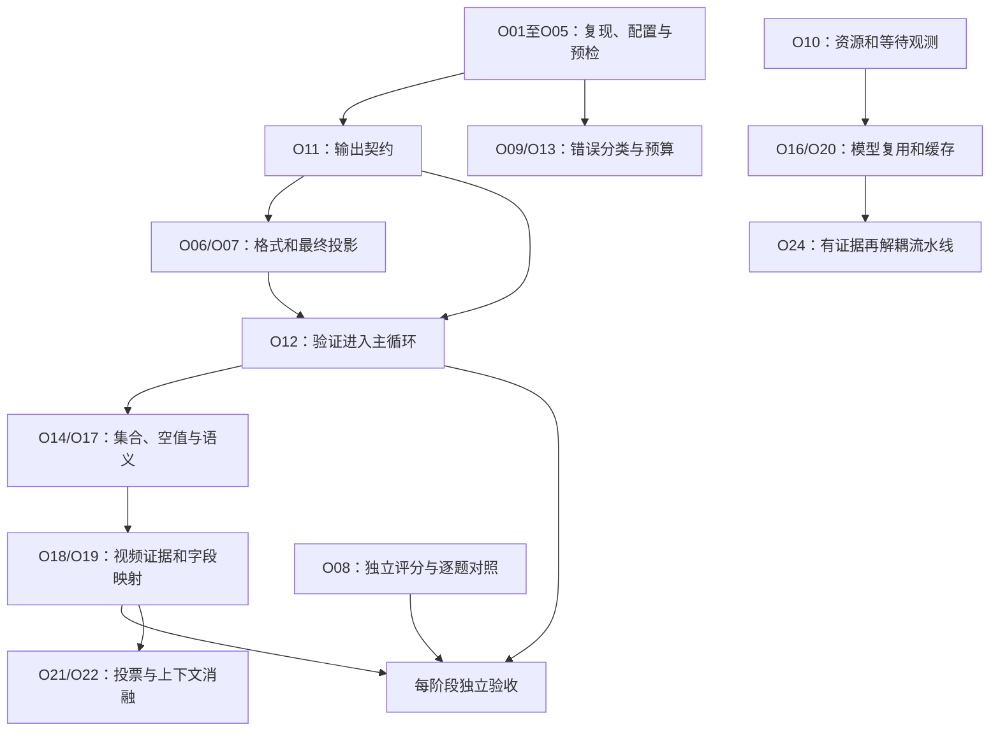

# Baseline优化修改总方案

规划日期：2026-10-26。现状代码基准：`c049a0d`；实验基准：`baseline_full_20261025`。本文是实施前计划，不代表所列改动、收益或新命令已经完成。

## 一、目标与成本口径

目标是在保持课程评分规则、公开60题范围和证据可追溯性的前提下，提高答案正确率与官方通过数，减少无效重试、延迟、内存压力和复现障碍。

当前基准为课程 **78.9027分**、官方 **40/60通过**、课程 **36满分/15部分分/9零分**。结果由33份plus历史输出与27份max补跑构成。教师75.6387分使用32份max和28份plus，与本轮不同；新方案首先应与当前可复现控制组比较，而不是把所有变化都称为超过教师基线的新增贡献。

本文按**预计开发人日**分档排序，1人日按约6～8小时有效开发计，包含必要验证；这是工作量估计，不是排期承诺。API实验耗时、服务等待和人工标注另列，不折算成开发时间。同档任务成本区间重叠，实际顺序还要遵守依赖。

收益分为四类：质量、稳定性、效率、可复现性。只有已定位差异能给出条件性算术空间，其余以待实验验证描述，不虚构“必涨X分”或“必快X倍”。

## 二、问题总览与证据强度

| 问题 | 当前证据 | 证据性质 | 对应任务 |
|---|---|---|---|
| 官方20题失败中11题首先报列数 | 独立评分；其中10题多列、1题缺列 | 已观测 | O07、O11、O12 |
| 日期与午夜时间戳归一不同 | task_10、86、328、389官方过、课程非满分；两个评分器实现不同 | 已观测 | O06、O08、O17 |
| 计数题返回明细、辅助字段进入答案 | task_123与300实际solver | 已观测 | O07、O11、O12、O14 |
| 目标行集、关联、空值或排名口径偏差 | 9道零分；task_18/129行数不符，182内容不符，196目标列未匹配 | 现象已知；若干唯一根因待核查 | O14、O17、O19 |
| 视频重复记录被常识质疑、分歧被投票压缩 | task_85投票日志及重算路径 | 已观测 | O18、O19、O21 |
| 重叠类别相加，缺少数值一致性检查 | task_102最终试跑solver | 已观测 | O14、O18 |
| 对缺失国籍作额外推断后扩大答案范围 | task_380输出及solver | 已观测；业务正确性需单独判断 | O11、O17、O19 |
| 文本预检通过但图片请求持续500 | 旧plus阶段1841次500；max同图验证成功 | 已观测 | O05、O09、O13 |
| 耗时高、长上下文、多轮投票 | 最后26题71分29秒，输入约23.73M token | 已观测；削减调用对质量的影响未知 | O16、O20～O24 |
| 内存压力与视频串行 | 六题阶段曾采样RSS约7.4GiB；现用4任务、2请求、视频单路锁 | 已观测；未取得连续峰值 | O10、O16、O24 |
| 已完成实验继续resume仍改会话状态 | `pending=[]`之后仍归档和写新会话 | 本次静态检查确认，不是原成绩失败原因 | O02 |
| 新环境缺少本机状态文件可能阻塞resume | 脚本直接读`docs/deployment-status.json`，该文件未提交 | 本次静态检查确认 | O01 |
| 自检显示可能丢前导零或把文本NA显示为空 | `_inspect_prediction`默认`pd.read_csv`自动推断 | 静态风险；未证明导致本轮某题零分 | O03 |
| 成绩提升、时间、模型差异容易混淆 | 不完整结果+36.8055分；超过教师+3.2640分；历史来源不同 | 已观测 | O08 |
| 单进程预算不能协调队友共享令牌 | 当前`RequestBudget`进程内生效 | 架构边界；非本轮已证实瓶颈 | O23 |
| 日志含重复图片与输入副本 | 本机运行约2GiB；文本日志压缩包约296MiB | 已观测 | O15、O20 |

来源为[完整复盘](../baseline-evaluate/README.md)、[逐题记录](../baseline-evaluate/task_analysis.csv)、[日志索引](../../runs/shared_public60_20261026/logs/README.md)。不把待核查假设当成已证实bug。

## 三、按开发成本排序的任务清单

优先级：P0表示首轮基础或直接质量改进；P1表示下一轮完善；P2表示在指标支持下实施。优先级与成本不是一回事。

### A档：0.25～0.5人日，低成本确定性修复

| 编号 | 任务 | 人日 | 优先级 | 收益类型 |
|---|---|---:|---|---|
| O01 | 本机状态文件缺失时可启动 | 0.25～0.5 | P0 | 复现性 |
| O02 | 已完成resume不再创建空会话 | 0.25～0.5 | P0 | 稳定性/来源完整 |
| O03 | CSV自检保留原始文本表示 | 0.25～0.5 | P0 | 质量/诊断准确 |

### B档：0.5～1人日，配置、格式与实验基础

| 编号 | 任务 | 人日 | 优先级 | 前置依赖 |
|---|---|---:|---|---|
| O04 | 统一配置加载与脱敏快照 | 0.5～1 | P0 | 无 |
| O05 | 增加多模态与工具往返预检 | 0.5～1 | P0 | O04 |
| O06 | 显式类型的输出格式规则 | 0.5～1 | P0 | O11最小版本 |
| O07 | 最终投影与答案形态控制 | 0.5～1 | P0 | O11最小版本 |
| O08 | 通用对照报告与退出后独立评分 | 0.5～1 | P0 | 无；与O04协同 |

O06、O07这里只计规则执行器的成本，不包含从自然语言可靠推导契约的成本；完整质量闭环还需要O11、O12。

### C档：1～2人日，运行闭环、约束与可观测性

| 编号 | 任务 | 人日 | 优先级 | 前置依赖 |
|---|---|---:|---|---|
| O09 | 按错误类型退避与熔断 | 1～2 | P1 | O04、O05 |
| O10 | 连续资源与排队监测 | 1～2 | P0 | O04 |
| O11 | 结构化输出契约 | 1～2 | P0 | 无；复杂含糊题可能超出区间 |
| O12 | 执行、契约检查与修正闭环 | 1～2 | P0 | O03、O11 |
| O13 | 分层重试与任务总预算 | 1～2 | P1 | O09、O12 |
| O14 | 计数、集合和排名一致性检查 | 1～2 | P1 | O11、O12 |
| O15 | 日志图片去重与分级留存 | 1～2 | P1 | O08 |
| O16 | 固定视频工作线程与ASR模型复用 | 1～2 | P1 | O10 |

### D档：2～4人日，语义、证据与缓存改造

| 编号 | 任务 | 人日 | 优先级 | 前置依赖 |
|---|---|---:|---|---|
| O17 | 空值、类型、单位和推断范围治理 | 2～3 | P1 | O11、O12 |
| O18 | 视频证据、候选分歧与来源结构化 | 2～3 | P1 | O11、O14 |
| O19 | 字段映射与数据覆盖验证 | 2～3 | P1 | O17、O18 |
| O20 | 分阶段视频缓存与身份校验 | 2～3 | P1 | O04、O10、O16 |
| O21 | 有分歧才追加的投票策略 | 2～4 | P2 | O18、O08 |
| O22 | 上下文按需加载与摘要 | 2～4 | P2 | O18、O19、O08 |
| O23 | 共享令牌的跨进程调用预算 | 2～4 | P2，条件性 | O04、O09；仅多人/多进程确有需求时 |

### E档：3～5人日，流水线结构调整

| 编号 | 任务 | 人日 | 优先级 | 前置依赖 |
|---|---|---:|---|---|
| O24 | 解耦CPU转写与截图网络处理 | 3～5 | P2 | O10、O16、O20；先证明串行等待值得改 |

以上工作共享契约、日志与实验基础，区间不能直接相加作为总工期。O21～O24也不是必须全部完成。

## 四、每项任务的问题、代码、修改方式与验收

以下路径除`scripts/`外，均相对 `champion/src/data_agent_baseline/`。所有“新增模块”都是拟议结构，不是现有文件。

### O01：新环境的运行状态初始化

- **问题与原因：** `scripts/resume_current_run.py`直接读取`docs/deployment-status.json`；干净克隆没有该本机文件。
- **修改：** 本机汇总状态作为可选信息，缺失时用明确schema初始化；内容损坏时保留证据并输出可理解的诊断。实验自身的manifest和凭据仍必须存在且通过校验，不能用空默认值绕过它们。
- **验收：** 在无该状态文件的隔离副本中恢复一个模拟未完成实验，不调用API也能走到启动前检查；文件存在/缺失两种情况都支持。
- **收益：** 移除队友复现阻塞，不承诺加分。

### O02：已完成实验resume保持只读

- **问题与原因：** 脚本计算`pending`后，无论是否为空都会新建`sessions/`并更新运行时间、状态，容易改变后续分析的“最新会话”。
- **修改：** 在严格校验且无需迁移/导入时，`pending=[]`立即报告完成并返回；不写状态、不要求真实调用。令牌校验移到确实需要请求模型的分支，不能为了查看已完成结果要求可用令牌。显式请求迁移或导入走独立分支，不能被提前返回吞掉。重评分使用明确入口，不隐式夹在查看状态中。
- **验收：** 无待处理任务的重复执行不产生新目录，所有原文件哈希与mtime保持不变；异常凭据仍报错。
- **收益：** 防止误计时和来源漂移；不改变答案。

### O03：自检按文本读取CSV

- **问题与原因：** `tools_v2/run_solver_tool.py::_inspect_prediction`默认类型推断，会把`00123`显示成数字，也可能把合法字符串NA视为空；这是反馈风险，非已证实本轮错误来源。
- **修改：** 用保留原文的读取方式展示值；另行计算“按约定为空”和“可解析数值”的诊断，不将诊断反写CSV。与`run_state.valid_csv`对严格结构检查的职责分开。
- **验收：** 前导零、NA字符串、空单元格、日期、中文和科学计数法展示准确，原CSV字节不变。
- **收益：** 模型基于真实输出反馈修正，降低误判；分数提升待验证。

### O04：配置来源统一且可核查

- **问题与原因：** `env.sh`默认值、`.env`覆盖、`--fast`调整及续跑读配置分散。终端临时赋值可能被`.env`覆盖，实验条件不易判断。
- **修改：** 拟新增`tools_v2/runtime_config.py`作为配置解析和校验核心，shell通过明确入口取得结果；统一定义默认→配置文件→显式CLI覆盖的优先级，并兼容旧方式或给出迁移提示。输出非敏感有效配置、每项来源和与旧manifest的差异。
- **验收：** 新跑/续跑/试跑对同一配置产生相同快照；令牌不进入打印或manifest；非法值启动前拒绝。
- **收益：** 减少错误实验与无法归因的条件变化，不直接加分。

### O05：覆盖图片与工具往返的预检

- **问题与原因：** `scripts/check_model.py`只验证文本echo工具，未覆盖导致此前大规模500的图片链路，也未完整验证工具结果返回后的第二次模型响应。
- **修改：** 保留离线检查，另加显式计费的在线预检：文本、单图、多图（按实际任务需要）、图像+工具请求及工具结果返回；按实际路由模型分别验证。通过后再做一题视频端到端冒烟。合成图片自生成，不读取gold。
- **验收：** 输出每个能力的状态/耗时/实际返回模型标识；文本成功、图像失败时不得标“全链路通过”；预检默认不启动全量。
- **收益：** 避免再次消耗约87分钟进行无有效产出的批量失败重跑；未来实际节省取决于是否再遇故障。

### O06：按显式语义格式化输出

- **问题与原因：** 4题日期表示造成评分差异；代码中没有统一的答案类型格式化层。数字、日期、代码不可一概转成相同形式。
- **修改：** 拟新增`tools_v2/output_finalize.py`，仅依据输出契约的类型与题意格式做转换；日期和datetime分别处理，保留时区与非午夜时间，代码保持字符串，空值策略显式配置。无明确依据的格式保持原样并记录不确定项。
- **验收：** 格式化幂等；不改变行集、数值单位或ID；两种评分器在Agent退出后独立评估。不得从gold或评测配置推断应输出的类型。
- **收益：** 日期4题理论空间约+2.7502分，但不保证符合题意的规则能全部获得该收益；不得牺牲题意来追逐评分表示。

### O07：最终投影与答案形态

- **问题与原因：** task_123输出明细而非计数；task_300输出排序辅助列。现有模板把查询结果直接`to_csv`，没有区分中间结果与答案。
- **修改：** 最小版本先支持题意明确的列映射；拟在`scaffold_tool.py`生成`query_result → finalize_result(contract) → prediction.csv`结构。只用契约中可映射到真实结果的列；字段不确定时要求修正，不能盲删未知列。缺列不能靠投影补齐；计数必须在正确粒度计算。
- **验收：** 排序字段可用于计算但不泄露到答案；用户明确要求的辅助字段不丢失；记录级TopN不被误去重。契约、数据处理和最终投影都有记录。
- **收益：** task_133、200、208、279、322、382、48这7道高部分分多列题的条件性课程空间约+0.5693分；它们只作为诊断案例，不写入通用算法分支。有机会改善官方通过，但不承诺7题全部通过。task_300与196还存在目标列内容不匹配，删列不是完整修复。

### O08：对照分析与独立评分统一

- **问题与原因：** 历史补跑、教师参考、单题延迟和全量墙钟混用；现有`analyze_experiment.py`针对本次历史修复阶段，不适合作为所有新实验通用分析器。普通新跑还需手动评分。
- **修改：** 保留历史分析脚本，拟新增`scripts/compare_runs.py`；自动校验任务集、评分口径、输入和结果来源，逐题输出增减分、通过变化、耗时/用量变化。统一支持Agent退出后评分，或显式`--evaluate-after`；评分失败与推理退出码分开记录。
- **验收：** 不同任务范围不能直接给“全量提升”；复用旧结果标明；全部正负变化与总差一致；Agent未结束时不读gold。
- **收益：** 使后续“改了什么、提高多少”可验证，本身不加分。

### O09：把接口故障与任务错误分开处理

- **问题与原因：** 多次相同500经任务重试放大；现有429退避不能替代持续服务故障诊断。
- **修改：** 在`model_http.py`与调度层建立错误类别：认证/权限、限流、服务5xx、连接、协议、工具执行、契约失败。持续同模型/能力5xx先做有上限退避，再暂停该能力的任务准入并运行最小诊断；429按返回等待信息处理。恢复条件可审查，不能静默换模型改变实验。
- **验收：** 模拟500/429/401/超时不会造成无限重试；取消/异常不泄漏请求许可；健康任务不因单题SQL错误被错误熔断。
- **收益：** 减少无效调用与等待；服务健康时不应明显降低吞吐。

### O10：建立连续资源与排队记录

- **问题与原因：** 只有离散内存采样；外层视频计时含锁等待，难以判断瓶颈。WSL为16GiB内存、8GiB swap、4CPU，任务数不等于CPU使用率。
- **修改：** 在`timing.py`、`monitor_run.py`及启动器采样主/子进程RSS、系统可用内存、swap、CPU与请求队列；视频记录入队、开始、各阶段服务时间。区分RSS求和与实际物理占用，不混称。内存低时先暂停新任务准入，不直接杀正在运行的任务。
- **验收：** 进程结束后计时冻结；峰值可追溯；采样自身开销可接受；阈值作为新配置保存，先观测再启用调度动作。
- **收益：** 支撑后续内存/并发优化，不能仅凭采样低值宣称内存问题根治。

### O11：把提示词约束变成结构化契约

- **问题与原因：** `agents_v2/solver_agent.py`已有列与粒度说明，但靠LLM自行遵守；没有可执行的输出要求。
- **修改：** 拟新增`tools_v2/output_contract.py`和必要的契约提取入口。优先复用一次规划/solver交互中的结构化产物，不默认每题再新增独立LLM调用。提取答案形态、列角色、过滤、排序、粒度、空值、单位、证据范围及明确程度。每条要求附题意或输入证据出处。
- **验收：** 区分计数/实体名单/原始记录/分组结果；显式“允许重复”优先；模糊要求为unknown而不是猜成硬约束。契约错误可回溯并修订，不能形成自证循环。
- **收益：** O06、O07、O12、O14的基础；新增推理成本需实测，不能假定免费。

### O12：契约检查进入结束条件

- **问题与原因：** 主循环当前`run_ok and CSV exists`即可结束；`run_solver`只提供可读反馈。
- **修改：** 拟新增`tools_v2/output_validate.py`，返回结构化检查项和原有可读说明；主循环区分执行成功、CSV有效、可判定契约通过、业务约束状态。明确失败进入有限修正循环；unknown记录但不伪称通过，也不无休止阻塞完成。
- **验收：** 违反明确契约的输出不会被标为通过；无证据的检查不能报“答案正确”。保存`validation.json`与schema版本，完成凭据记录检查摘要。旧凭据语义不就地改写，新实验使用新schema。
- **收益：** 防止“跑通即结束”漏掉可机器发现的错误；可能增加单题耗时，需看净质量收益。

### O13：按失败阶段设置修复与预算

- **问题与原因：** 现有最多5次attempt、每次80请求，接口故障与语义疑点未充分区分；重跑前恢复初始脚手架有价值，但未必适合所有修复。
- **修改：** 区分transport重试、脚本执行修复、契约修复和证据补查；每类设次数与任务总调用/时间预算。保留恢复脚手架机制，但可运行脚本的局部契约修复优先做最小修改，不把已验证的中间成果全部丢弃。
- **验收：** 达到预算时保存最后状态与未解决原因，不伪造成功；不同修复路径可统计；禁止隐藏的多层重试乘积失控。
- **收益：** 减少无效重跑，提升长尾可控性；预算过严可能降低覆盖，需对照。

### O14：聚合与集合一致性

- **问题与原因：** task_102类别重叠仍求和，123漏聚合；排名、并列与重复记录是多题关注点。
- **修改：** 在统一验证模块中表达可证明的规则：同范围去重实体数≤原始记录数，集合并集不能直接用类别计数求和，计数可由明细复算，TopN是否保留并列由契约决定。只对同一范围使用上界；证据不完整则标unknown。
- **验收：** 覆盖重叠集合、跨年记录、边界并列、重复公司、空集合、范围不一致；不内置题号与正确数值。
- **收益：** 有机会修复零分语义错误；一题0→100对60题均分贡献1.6667分，但不承诺任何具体题必能修满。

### O15：日志留存完整而减少重复

- **问题与原因：** 对话中重复编码图片使保留文本约473MiB、压缩包约296MiB；原目录还有重复输入副本。
- **修改：** 日志中的图片和大工具输出可按内容哈希单独存放，用引用连接；对外导出时提供完整可解析包。区分正常摘要、完整复盘与失败调试级别。保留时间、模型、工具结果和来源链，不因去重丢证据。原基准归档不覆盖。
- **验收：** 每条引用可恢复、哈希一致；可从包重建必要对话；脱敏扫描覆盖独立资产与嵌入内容；队友拿到的包不依赖负责人本机路径。
- **收益：** 存储和分享成本下降，比例需实测；日志去重本身不减少发往API的图片或token。

### O16：固定工作线程与ASR模型生命周期

- **问题与原因：** `run_video`用默认线程池加单路锁；`audio_transcribe._build_model`在调用路径构造模型。重复构造与不同线程的内存保留值得优化，但具体峰值原因未证实。
- **修改：** 专用单worker视频执行器，按权重路径/哈希、设备、量化和线程配置缓存模型，限定tiny/medium实例数量；正确传递task上下文。模型常驻可能提高RSS基线，必要时提供回收策略。继续限制CPU并发，不能简单增加ASR worker。
- **验收：** 相同输入的转写与时间戳可对照；任务取消、线程异常、模型重建可恢复；记录加载次数、RSS和冷/热延迟。不要承诺位级确定性。
- **收益：** 减少重复加载和线程分散；是否降低峰值与墙钟由O10证明。

### O17：缺失值、类型、单位与推断范围

- **问题与原因：** 行集与字段内容失败集中；task_380体现外部简介推断改变结果范围。零值、空值、文本NA、ID与数字不能混用。
- **修改：** 在`datasource_runtime.py`、`schema_inference.py`、契约/格式层明确字段角色、数据类型和转换来源；保留原值和转换记录，禁止为方便统一填0或全局过滤NULL。单位换算必须带来源和量纲；额外文本推断单独标注，不默认并入显式字段筛选。
- **验收：** 前导零ID、微小正负数、百分比/元/亿元、空记录、部分关联、并列排名与日期边界；对待核查题逐步定位，不先假定所有错题都是单位bug。
- **收益：** 改善跨题通用正确性，覆盖面大但分数不可预估；可能增加代码复杂度，应按实际案例逐类引入。

### O18：视频证据和分歧候选保留

- **问题与原因：** `video_result_agent.py`多数未过时直接重算，摘要未保留全部候选信息；task_85展示同一模型反复判断仍会共享偏差。
- **修改：** 在视频输入/判断中保存`EvidenceBundle`：帧/时间、原文、观察值、口径、覆盖完整性、候选答案、分歧。决策区分未展示、覆盖不足、冲突、可验证；最终solver可读取争议，而不是只有单条重算结论。当前原视频仍可供solver使用，计划改善的是摘要路径而非声称原证据完全丢失。
- **验收：** 重复记录不自动判不可信；视频只给配置时不冒充完整名单；候选范围与原帧可追溯；置信度不当作经过校准的概率。
- **收益：** 改善复杂视频题的证据使用；结构化保存会增加元数据，配合O15控制体积。

### O19：映射字段前验证语义与覆盖

- **问题与原因：** 视频字段与结构化表相似不代表同一范围；task_85回表路径存在这种风险。task_182等关联错误的唯一根因仍未确定。
- **修改：** 在`table_relevance_agent.py`、`describe_tool.py`与查询规划中记录候选表、字段解释、粒度、时间范围、单位、覆盖率、关联键；少量确定性查询验证唯一性、匹配率与边界。表相关性不能只按名称相似打分；缺数据应明确报告，而不是替换成近似表。
- **验收：** 多对多关联不会悄悄放大行数；缺失关联不被无声丢弃；不能从评测gold或配置借用映射。
- **收益：** 降低错误关联与错误回表；额外探查有成本，应只对不确定映射启动。

### O20：视频分阶段缓存

- **问题与原因：** 当前有文档完整产物缓存，但视频预处理在重复实验中仍有成本；26题ASR任务时间合计约32分45秒，不能当作可直接节省的墙钟。
- **修改：** 参考`artifact_cache.py`拆分帧、语言检测/转写、版面识别、题目相关视频判断缓存。键包含输入哈希、ASR权重、参数、代码/依赖、模型/端点、提示词、题目及knowledge依赖；不同阶段只包含实际依赖。部分失败不共享，原子写入，有效期/模型版本策略明确。
- **验收：** 改变影响结果的任一参数必失效；同身份复用成功；损坏/缺资产缓存退回重建；不缓存gold或最终答案来冒充独立运行。
- **收益：** 缓存复跑可显著减少重复工作；冷启动没有同等收益。缓存命中导致随机抽取结果被固定，需在实验协议中说明。

### O21：按分歧追加投票

- **问题与原因：** 前置相关性3轮、视频答案判断5轮固定投入，同一模型多票不等于独立证据。
- **修改：** 先保留原策略做控制组，再试“初判→低成本一致性检查→有分歧才追加”；明确触发条件和最大轮次，配置写入身份。阈值不能只针对公开零分题调优后宣称泛化。
- **验收：** 在独立全量或预先固定的分层样本比较调用数、通过数、零分数与延迟；节省调用但质量下降不算完成。
- **收益：** 降低token与延迟的可能性较高，但收益方向仍需验证。

### O22：上下文按需提供

- **问题与原因：** 补跑输入约23.73M token，重复schema、文档与视频上下文可能占较大比例；尚未精确归因每类占比。
- **修改：** 先统计阶段token，再把完整schema/文档/视频证据变为可检索的按需工具，固定保留题意、输出契约和证据索引；摘要附原始出处。不能为了缩短上下文丢掉NULL、单位、并列或范围约束。
- **验收：** 关键证据仍可恢复；统计缓存token与总token；相同评测条件下质量不退化，工具多跳增加的时间也计入。
- **收益：** 有望减少输入用量与长上下文干扰，不能预先承诺费用比例或分数。

### O23：多人共享服务预算

- **问题与原因：** `speed_runtime.RequestBudget`只在一个Python进程中共享；队友同时启动会叠加服务端额度。
- **修改：** 优先通过团队排队/单入口运行避免复杂基础设施；确有需求再提供跨进程协调器，统一并发、RPM及可获得的token预算。处理租约过期、异常退出和请求取消；不同模型/服务预算按真实限额配置，不硬编码旧限制。
- **验收：** 两进程合计不超配置上限，进程崩溃不永久占槽；令牌不入协调状态或日志。
- **收益：** 仅多进程共享时有价值；当前单进程4题并行不需要先做此项。

### O24：解耦视频CPU与网络阶段

- **问题与原因：** 当前锁覆盖整个视频函数，CPU转写与截图网络等待可能都占住单路，吞吐受串行路径约束。
- **修改：** 建立有界分阶段流水线：抽帧/ASR单CPU worker → 截图请求共享HTTP预算 → 证据合成；图像队列限制内存，不批量把所有帧常驻RAM。先保持模型、帧选择与提示词不变，只调整调度。
- **验收：** 记录排队、服务与重叠时间；共享HTTP许可含同步线程；任务上下文不串题；取消不泄漏资源；16GiB/4CPU配置下峰值和总墙钟可复核。
- **收益：** 有望缩短串行等待，但要先由O10证明瓶颈；不得把阶段累计时间当作可直接节省的墙钟，也不预先宣称速度倍数。

## 五、拟议代码结构与数据流

```text
champion/src/data_agent_baseline/
├── zz_agent_v2.py                   修改：分层状态机、有限修复、完成条件
├── agents_v2/
│   ├── solver_agent.py             修改：输出契约与证据使用
│   ├── video_result_agent.py       修改：保留候选、覆盖和分歧
│   └── table_relevance_agent.py    修改：语义/覆盖检查
├── tools_v2/
│   ├── runtime_config.py           拟新增：有效配置与来源
│   ├── output_contract.py          拟新增：契约schema与证据出处
│   ├── output_finalize.py          拟新增：投影与显式类型格式化
│   ├── output_validate.py          拟新增：确定性检查与unknown状态
│   ├── run_solver_tool.py          修改：执行反馈与结构化验证
│   ├── scaffold_tool.py            修改：中间结果与最终答案分离
│   ├── run_state.py                修改：新设置指纹、检查摘要/schema版本
│   ├── model_http.py               修改：错误分类与有界恢复
│   ├── speed_runtime.py            修改：工作线程与分阶段预算
│   └── artifact_cache.py           扩展：按真实依赖定义缓存身份
└── video/
    ├── audio_transcribe.py         修改：受控模型生命周期
    └── build_video_input.py        修改：证据结构与阶段缓存接入
scripts/
├── resume_current_run.py           修改：新环境与完成幂等
├── check_model.py                  扩展或由新预检入口兼容调用
├── run_tasks.sh                    修改：配置统一、可选退出后评分
├── compare_runs.py                 拟新增：通用逐题对照
├── monitor_run.py                  扩展：连续资源记录
└── test_*.py                       增补有必要的行为验证
```

以上只定义职责，不要求一次性拆出所有新模块。能在现有清晰边界内实现的小改动，不为模块化而强制重写。

拟新增运行产物（示例）：

```text
runs/<new_run>/
├── effective_config.json          脱敏有效配置、来源、特性开关
├── run_manifest.json              代码/输入/模型/新设置指纹
├── predictions/task_*/
│   ├── prediction.csv             最终原始预测
│   ├── completion.json             完成与来源凭据
│   ├── output_contract.json        题意要求、证据、版本
│   └── validation.json             可判定检查和unknown项
├── temp/logs/task_*/
│   ├── evidence.json               帧/文本/范围/候选/分歧
│   └── repair_history.jsonl        失败类别、反馈、修复与预算
├── resource_samples.jsonl         资源、请求队列与阶段等待
└── evaluation.json                Agent结束后独立生成
```

不能把“validation通过”命名成“答案正确”。没有gold的运行期验证只能证明约束满足。

## 六、依赖顺序与实施里程碑



### M0：先让实验可复现、可对比

实施O01～O05、O08、O10的最小必要部分，预计约2～4人日，按实际范围调整。产出统一配置、预检结果、原基准来源索引、可靠的空续跑行为与对照报告；不要求此阶段涨分。

### M1：最小可交付质量版本，优先建议

O11的明确题意子集 → O07最终投影 → O12明确规则验收 → O06显式格式，预计约2～4人日用于最小范围，不含复杂自然语言歧义治理。保留unknown出口，避免把猜测强制成规则。

目标是先修复可确定的输出规范错误，以零分数不增、官方通过改善且无大面积回归作为继续条件。7道多列高部分分题是诊断组，不是代码中硬编码的题目集合。

### M2：业务正确性版本

实施O14、O17～O19及所需O13，追加约4～8人日可形成第一批能力，复杂范围按结果拆分。优先解决计数/粒度/证据范围的通用问题，逐项解释9道零分题；不承诺全部消除零分。

### M3：运行成本版本

O16、O20优先，O21/O22/O24按O10的观测选择；首批约4～8人日，不等于全部性能任务成本。质量版本冻结后分别做冷/热、单独特性的对照，避免同时改模型和流水线导致无法归因。

O15随工程需要安排；O23只有实际多人并发共享服务时再启动。各阶段人日共享基础工作，不能机械相加预测日历完成时间。

## 七、预期收益：可算空间与不可承诺部分

| 改进对象 | 现有证据支持的空间 | 解释 |
|---|---:|---|
| 7道高部分分多列题 | 条件性约+0.5693分 | 正确目标列不变且冗余列全部消除；官方通过改善仍需整表核查 |
| 4道日期差异题 | 条件性约+2.7502分 | 必须符合题意、统一规则且不影响其他题；非已验证收益 |
| 上述两组全部修复且无回归 | 78.9027→约82.2222 | 仅算术情景，不是交付承诺或普适上限 |
| 任一零分题0→100 | +1.6667分 | 每题等权；具体能否修满未知 |
| 9道零分当前损失 | 共15分 | 不是预计全部可回收的收益 |
| 失败预检/熔断 | 防止无效批量重跑 | 无服务故障时不产生同样时间收益 |
| ASR复用/视频缓存 | 可能减少重复加载和热运行成本 | RSS常驻、随机抽取冻结、冷/热差异都需记录 |
| 少投票/短上下文/流水线 | 待测 | 不能保证质量不降，也不能按阶段时长直接推导提速倍数 |

当前+3.2640分是相对教师的既有差值；未来收益必须相对冻结的当前控制组重新计算，不能把旧修复收益重复累计。不同实验、不同缓存条件或不同模型的改善不能直接相加。

## 八、实验与验收方案

### 8.1 先做不计费验证

1. 沿用现有28项离线测试，新增有必要的行为用例：契约明确/含糊、记录级重复、计数/明细、日期/时区、ID前导零、空值、缓存失效、限流取消、无状态文件和空续跑。
2. 固定原预测与凭据为只读基准；对格式化、投影等纯后处理，可在新目录从原输出运行通用规则，记录父CSV哈希和变换版本，结束后独立评分。这属于后处理诊断，不是新Agent冷启动全量结果。
3. 对语义修复用合成或独立案例验证，不能编造“task_102正确答案”等题号分支；不为可逆文档改动新增无意义测试。

### 8.2 有限在线验证

先预检，再按预先固定的分层小样本验证：明确输出列、计数、日期、无视频、有视频、原本成功题都应覆盖。可用已知问题题目做诊断，但选择偏差必须声明；不能把诊断集改进当成60题泛化收益。

API预算明确记录预检次数、单题最大调用/墙钟、实验范围和停止条件。提供商没有稳定模型版本或seed支持时如实记录返回标识与时间，不能声称完全确定性复现。

### 8.3 正式全量控制组与实验组

| 条件 | 要求 |
|---|---|
| 控制组 | 尽可能在同一时间窗，以冻结代码/配置完成一轮干净60题；历史混合基准仍保留作为参照 |
| 任务与输入 | 固定公开60题及输入哈希；不读取gold参与求解 |
| 模型 | 同一模型分配、思考设置、服务地址；不同时换模型测试代码收益 |
| 环境 | 同WSL资源、依赖、任务顺序和请求预算；记录可用内存与其他负载 |
| 缓存 | 冷启动和缓存复跑分别标记；冷启动禁用或隔离允许改变推理结果的缓存，不删除原缓存证据 |
| 结果来源 | 新实验独立目录；不复用旧最终CSV冒充新方案全量；同一新身份的中断可正常续跑 |
| 评分 | 两种评分器在结束后独立运行；版本、配置与λ固定 |
| 重复 | 预算允许时至少重复一轮并报告波动；仅一轮只能称初步结果，不作显著性宣称 |

现有数据可以支持配对逐题增减分，不能在缺少教师结果时构造教师逐题对照。

### 8.4 每项改动完成的定义

- **质量项：** 对目标通用问题提供可复核证据；报告所有退化题，不只报改好题；课程、官方、零分与覆盖同时给出。
- **效率项：** 在同质量条件下报告总墙钟、吞吐、延迟分布、请求数、token及连续RSS；若少调用造成质量下降，保留为取舍实验而非直接宣布优化成功。
- **稳定性项：** 能复现原故障并验证恢复，不破坏取消、完成凭据和续跑严格校验。
- **文档与交付：** 配置模板、运行说明、变更范围、实验身份、已知限制同步，报告与真实产物一致。

建议默认晋级条件：覆盖不下降、零分不增加、两种质量指标均不下降，并至少改善一个目标指标。如果有质量/速度权衡，先单列结果，不能默认合并进主配置。

## 九、实现中的兼容与回滚

1. 原`baseline_full_20261025`、共享预测归档和Release日志不变；新方案在新分支、新目录实施。
2. 新功能使用显式、可记录的开关与schema版本。示例名如`KDD_OUTPUT_VALIDATION`仅为设计草案，当前并不存在；不要把方案中的示例配置当成已支持命令。
3. `run_state.run_identity`已自动哈希`champion/src`内Python文件，新模块会纳入源码身份；还要把新投票/缓存/格式/预算设置加入配置身份，不能只增加环境变量却漏记。契约产物和验证规则需在来源中可追溯。
4. 新质量逻辑改变了推理条件，旧完成凭据不能直接升级复用；若做后处理诊断，保留父输出和新身份。现有严格续跑不能为了方便被关闭。
5. 完成凭据增加执行状态、契约状态和unknown项的明确字段，保留旧schema解析边界；只做CSV有效性检查不得标成业务正确。
6. 开关关闭的兼容路径先做离线/固定输出检查；即使代码行为预期相同，源码身份变化也必须按现有规则处理，不伪装成原实验。
7. 如果新规则误伤已成功题，先回退对应特性并保留失败契约和证据，不按题号加例外。
8. 不改课程评分器、不把gold或评测配置注入Agent、不按已知答案改CSV。最终独立评分可以读取gold，但与解题过程严格分开。

## 十、推荐团队分工与首轮任务

| 工作方向 | 首轮职责 | 后续职责 |
|---|---|---|
| 运行与实验 | O01/O02/O04/O05/O08 | O09/O10/O13、固定全量对照 |
| 输出与数据 | O03/O11/O07/O12/O06 | O14/O17、排名/关联错误复盘 |
| 视频与证据 | 收集证据，不先改投票轮数 | O18/O19，再按观测做O16/O20 |
| 报告与质量复核 | 检查契约是否来自题意、汇总全部增减分 | 冷/热与模型对照、收益归因、文档更新 |

可按实际人数合并角色，不要求启用多Agent开发。首轮建议只承诺：**完成复现基础和最小输出契约闭环，取得一份独立、可解释的对照结果**。日期、零分语义与性能随后逐项验证，避免同时修改全部模块。

## 十一、引用与相关资料

- [当前Baseline总结](../baseline-evaluate/Baseline全量实验总结与评价.md)
- [详细现状分析与代码链接](../baseline-evaluate/README.md)
- [最终逐题评分](../../results/public60_20261026/evaluation.json)
- [日志索引](../../runs/shared_public60_20261026/logs/README.md)
- [运行与续跑](../../docs/加速运行与断点续跑.md)
- [团队使用指南](../../docs/TEAM_GUIDE.md)

本计划没有执行上述修改、模型调用或新实验；预计工期、收益与新模块设计均需在实施后用产物验证。
